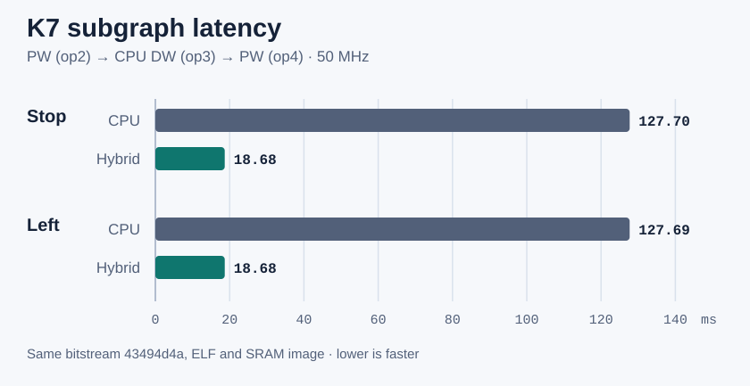
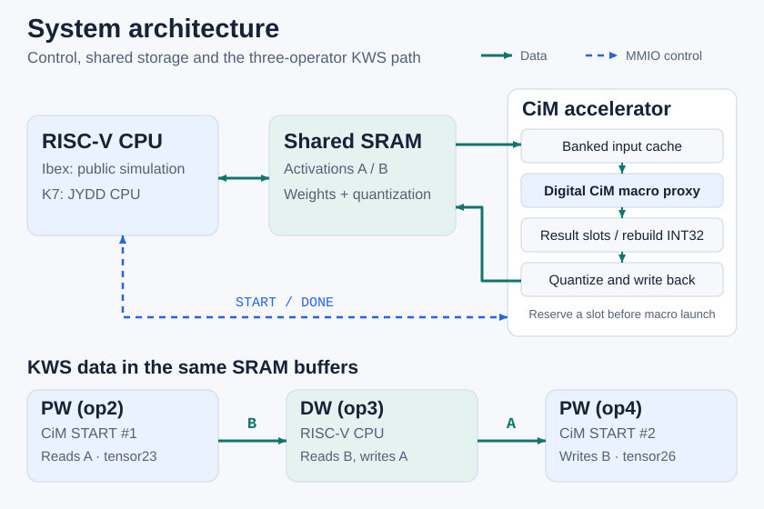

# RISC-V CiM Accelerator

RISC-V-controlled INT8 acceleration with a synthesizable CiM macro proxy, open Ibex simulation, and a K7-validated KWS subgraph.

[简体中文](README.zh-CN.md) · [Stable release v0.4.0](https://github.com/zlsjtj/riscv-cim-accelerator/releases/tag/v0.4.0) · [Apache-2.0](LICENSE) · 

- **6.83–6.84× speedup** for the three-operator subgraph on K7 at 50 MHz, measured against the same-firmware scalar RV32IM C path. [Board data](docs/evidence/kws_subgraph/k7_board.json)
- **50 MHz on Kintex-7**, with both paths measured on one bitstream and one ELF. [Board setup and timing](docs/evidence/kws_subgraph/k7_build.json)
- **96,000 diagnostic bytes matched** TensorFlow 2.16.1 across two samples, two paths and three captured tensors per run. [Per-tensor results](docs/evidence/kws_subgraph/k7_board.json)

[Quick Start](#quick-start) · [Architecture](#architecture) · [Board Results](#board-results) · [Design Walkthrough](docs/DESIGN_TALK.md)

## Quick Start

Use Ubuntu or WSL with the [public Ibex toolchain](docs/IBEX.md#开放-ibex-整机复现). From the repository root:

~~~bash
python3 tools/run_ibex.py
~~~

Expect `PASS Ibex M=1`, two verified INT8 output files and a result JSON under `build/ibex/M1/`. This is a synthetic two-layer smoke test with real CPU execution in RTL simulation. [Smoke-test outputs](docs/IBEX.md)

## Board Results

| Published MFCC input | Scalar RV32IM C | Hybrid CiM / CPU / CiM | Latency ratio |
|---|---:|---:|---:|
| Stop | 127.703 ms | 18.679 ms | 6.84× |
| Left | 127.694 ms | 18.685 ms | 6.83× |

The two PW layers and CPU DW run from restored input to the final output word becoming readable. The timer includes submissions, polling and CPU work. Comparison and printing follow the timing window. Each timed run checks 8,000 final bytes. The separate diagnostic runs capture all three outputs, totaling 96,000 checked bytes. CPU DW accounts for **94.94%** of hybrid latency. [Raw JSON](docs/evidence/kws_subgraph/k7_board.json) · [Stage cycles and measurement scope](docs/KWS_SUBGRAPH.md#k7-50-mhz-实测)

## Architecture

- **Low-bit arithmetic.** The digital macro proxy consumes bit planes and returns native partial sums. The controller combines signed and unsigned nibbles into INT32 accumulators.
- **Storage and backpressure.** The controller reserves result space before a macro launch, replays input from a banked scratchpad, and releases an output context after its last SRAM write is accepted.
- **Quantization and handoff.** Per-channel integer double rounding produces INT8. For the KWS path, the CPU reads PW1 output in B, runs DW into A, then starts PW2 on the actual contents of A. [RTL architecture](docs/ARCHITECTURE.md) · [Five-minute walkthrough](docs/DESIGN_TALK.md)

## Reproduce the KWS Subgraph

Prepare the fixed model and the two published MFCC samples with TensorFlow 2.16.1, then run the open Ibex system. The diagnostic option runs a separate capture after the timed paths and verifies tensor24, tensor25 and tensor26. [Dependencies, commands and outputs](docs/REPRODUCE.md)

The K7 path uses Vivado 2023.2, an authorized local JYDD CPU/UART tree, an RV32IM toolchain, the board, JTAG and UART. [Board commands](docs/KWS_SUBGRAPH.md#复现) · [Recorded UART log replay](docs/DEMO.md)

| Platform | Verified scope |
|---|---|
| [K7 FPGA at 50 MHz](docs/KWS_SUBGRAPH.md#k7-50-mhz-实测) | Real three-operator subgraph, two samples and both paths, with timing and byte checks |
| [Ibex RTL simulation](docs/KWS_SUBGRAPH.md#ibex-rtl-仿真) | RV32IM firmware executes both real subgraph paths, plus a separate synthetic smoke test |
| [Standalone RTL CI](.github/workflows/rtl.yml) | Official integer reference checks, unit tests and INT8 pointwise regression with fixed and variable memory latency |

| Explore | Files |
|---|---|
| Hardware | [Controller](rtl/cim_accel.sv), [macro proxy](rtl/cim_macro.sv), [requantizer](rtl/requant.sv) |
| Software and tools | [KWS firmware](sw/kws_main.c), [driver](sw/cim.c), [fixture preparation](tools/prepare_kws.py) |
| Evidence and history | [Current status](docs/STATUS.md), [development history](docs/STATUS_HISTORY.md), [release notes](docs/RELEASE_v0.4.0.md) |

The validated scope is a fixed three-operator KWS subgraph and a digital macro proxy. Optional follow-up work includes the CPU DW kernel, more inputs and a higher clock. Project code is [Apache-2.0](LICENSE). External sources retain their own terms. [Third-party sources and terms](docs/THIRD_PARTY.md)
