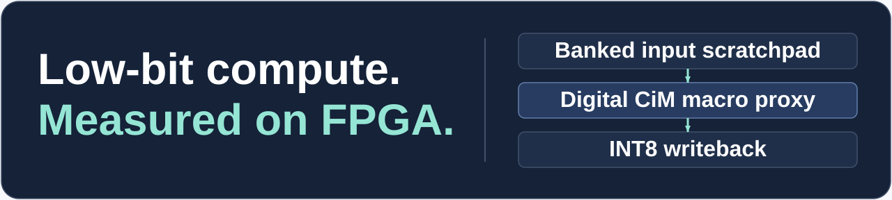
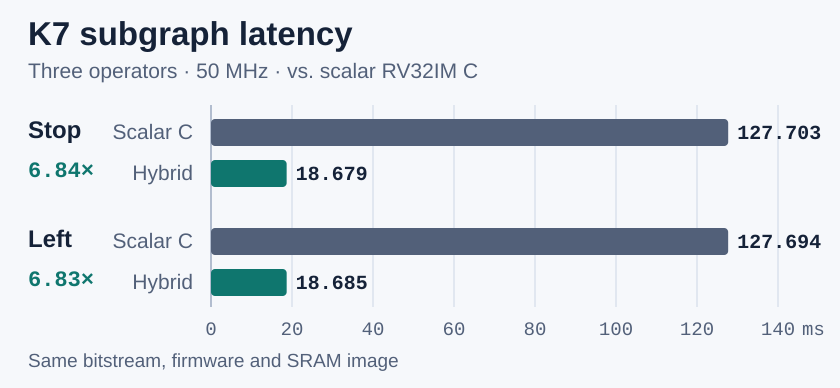
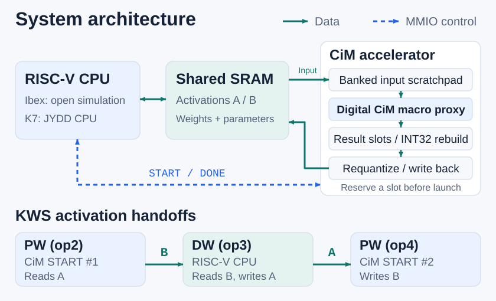
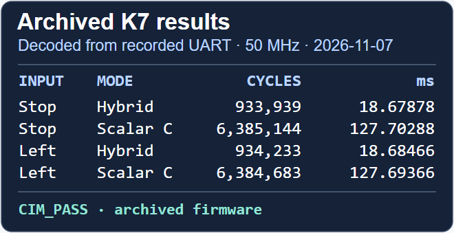

# RISC-V CiM Accelerator

<picture>
  <source media="(max-width: 600px)" srcset="docs/assets/hero-narrow.svg">
  
</picture>

RISC-V-controlled INT8 acceleration with a digital CiM macro proxy, open Ibex simulation, and Kintex-7 measurements.

[简体中文](README.zh-CN.md) · [v0.4.0 Release](https://github.com/zlsjtj/riscv-cim-accelerator/releases/tag/v0.4.0) · [Apache-2.0](LICENSE) · 

- **6.83–6.84× speedup** on K7 at 50 MHz. [Board results](#measured-results)
- **96,000 diagnostic bytes**, zero mismatches. [Per-tensor evidence](docs/evidence/kws_subgraph/k7_board.json)
- **Open Ibex** RTL simulation, with no board required. [Setup](docs/REPRODUCE.md#quick-start-with-the-open-cpu)

The measured KWS subgraph runs pointwise (PW) → CPU depthwise (DW) → pointwise. Both paths use the same bitstream and firmware. The baseline is scalar RV32IM C. [Original board JSON](docs/evidence/kws_subgraph/k7_board.json)

[Quick Start](#quick-start) · [Results](#measured-results) · [Architecture](#architecture) · [Demo](#demo) · [Design Walkthrough](docs/DESIGN_TALK.en.md)

## Quick Start

Reproduce the stable v0.4.0 functionality on Ubuntu 24.04 or WSL with Ubuntu 24.04. The latest showcase documentation is on [main](https://github.com/zlsjtj/riscv-cim-accelerator/tree/main).

~~~bash
sudo apt-get update
sudo apt-get install -y git verilator gcc-riscv64-unknown-elf g++ make libelf-dev python3-venv

git clone --branch v0.4.0 --single-branch https://github.com/zlsjtj/riscv-cim-accelerator.git
cd riscv-cim-accelerator
python3 -m venv .venv
source .venv/bin/activate
python3 -m pip install -r tools/requirements-ibex.txt
python3 tools/run_ibex.py
~~~

Expect `PASS Ibex M=1` and two verified INT8 outputs plus `result.json` in `build/ibex/M1/`. This smoke test runs a synthetic two-layer workload on the Ibex RTL CPU.

## Measured Results

| MFCC input | Scalar C (ms) | Hybrid (ms) | Speedup |
|---|---:|---:|---:|
| Stop | 127.703 | 18.679 | 6.84× |
| Left | 127.694 | 18.685 | 6.83× |

The timer runs from restored input to the final output word becoming readable. It includes submissions, polling, CPU DW and handoffs. Checks and printing follow the window. Each timed run checks 8,000 final bytes. Separate diagnostics compare two inputs × two paths × three captured tensors × 8,000 bytes against TensorFlow 2.16.1. [Board setup](docs/evidence/kws_subgraph/k7_build.json) · [Stage cycles and timing window (中文)](docs/KWS_SUBGRAPH.md#k7-50-mhz-实测)

## Engineering Highlights

- **Low-bit INT8 reconstruction.** The digital macro proxy consumes four activation bit planes. The controller combines unsigned low and signed high weight nibbles, then merges the two activation slices into INT32 before per-channel requantization. An independent integer MAC checks the numerical contract. [Macro](rtl/cim_macro.sv) · [Controller](rtl/cim_accel.sv) · [Reference](tools/reference.py)
- **Scheduling under backpressure.** Macro results arrive without a ready handshake, so the controller reserves a result slot before launch. A banked input scratchpad replays input across output tiles. A context stays live until its final SRAM write commits. [Controller](rtl/cim_accel.sv) · [Timing and regression (中文)](docs/SRAM_TURNAROUND.md#优化合同与覆盖) · [Banked replay (中文)](docs/BANKED_REPLAY.md)
- **Measured CPU–accelerator handoff.** CPU DW consumes the actual PW1 output from SRAM, then PW2 consumes the actual DW output. One firmware runs both paths and captures intermediate tensors in a separate diagnostic pass. [Firmware](sw/kws_main.c) · [Subgraph (中文)](docs/KWS_SUBGRAPH.md) · [UART](docs/evidence/kws_subgraph/k7_board_uart.txt) · [JSON](docs/evidence/kws_subgraph/k7_board.json)

## Architecture

[Five-minute design walkthrough](docs/DESIGN_TALK.en.md) · [Detailed RTL architecture (中文)](docs/ARCHITECTURE.md)

## Demo

Static summary of four archived K7 runs, decoded from the recorded 50 MHz UART log. [Replay command and original transcript](docs/DEMO.md)

## Reproduce the KWS Subgraph

Run the fixed model with published Stop and Left inputs in Ibex. The K7 flow uses Vivado 2023.2, authorized local JYDD CPU/UART sources and the supported board. [English reproduction guide](docs/REPRODUCE.md) · [K7 commands (中文)](docs/KWS_SUBGRAPH.md#复现)

| Platform | Verified scope |
|---|---|
| [Kintex-7 (中文)](docs/KWS_SUBGRAPH.md#k7-50-mhz-实测) | Fixed KWS subgraph, both paths, timing and byte checks |
| [Open Ibex](docs/REPRODUCE.md#real-kws-subgraph-in-ibex) | Real RV32IM execution for both KWS paths and the synthetic M1 smoke test |
| [Standalone RTL CI](.github/workflows/rtl.yml) | Integer reference, units and INT8 pointwise regression with fixed and variable memory latency |

[RTL](rtl/) · [Firmware](sw/) · [Fixture preparation](tools/prepare_kws.py) · [Status (中文)](docs/STATUS.md) · [History (中文)](docs/STATUS_HISTORY.md)

Project code uses [Apache-2.0](LICENSE). External sources retain their own terms. [Third-party sources and terms (中文)](docs/THIRD_PARTY.md)
