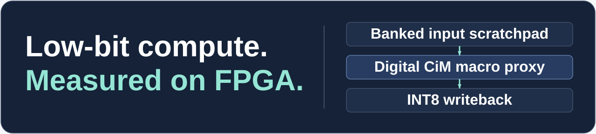
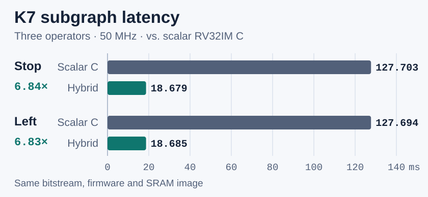
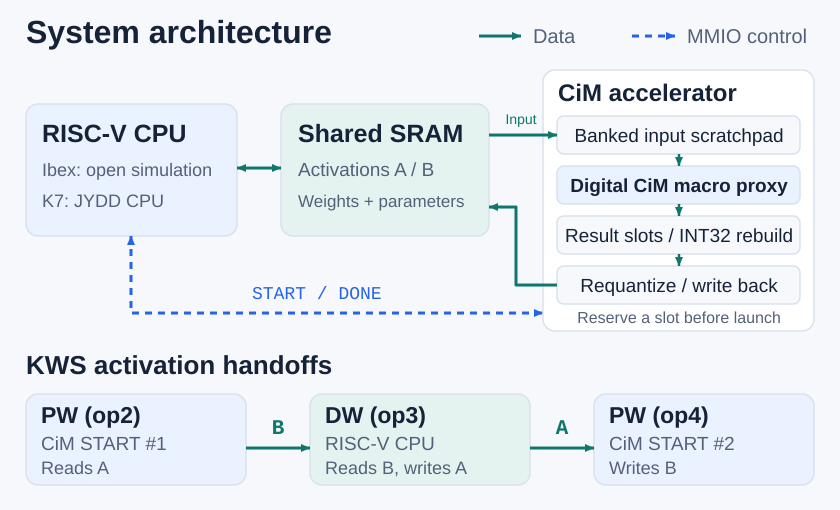
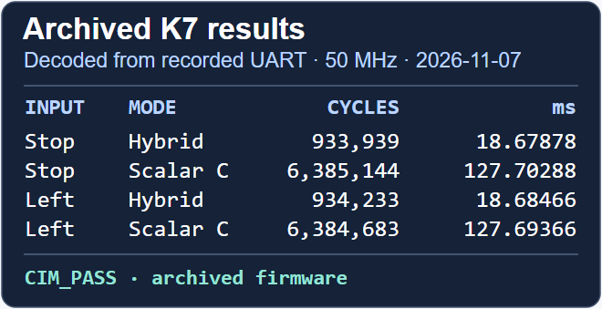

# RISC-V CiM Accelerator

<picture>
  <source media="(max-width: 600px)" srcset="docs/assets/hero-narrow.svg">
  
</picture>

RISC-V 控制的 INT8 加速器，包含 CiM 宏数字代理、开放 Ibex 仿真和 Kintex-7 实测。

[English](README.md) · [v0.4.0 发布版](https://github.com/zlsjtj/riscv-cim-accelerator/releases/tag/v0.4.0) · [Apache-2.0](LICENSE) · 

- **6.83–6.84× 加速**，K7 50 MHz 实测。[板测结果](#板测结果)
- **96,000 字节诊断比对**，零失配。[逐张量证据](docs/evidence/kws_subgraph/k7_board.json)
- **开放 Ibex** RTL 仿真，可在无板环境运行。[安装说明（英文）](docs/REPRODUCE.md#quick-start-with-the-open-cpu)

实测 KWS 子图执行逐点卷积 (PW) → CPU 逐通道卷积 (DW) → 逐点卷积。两条路径使用同一位流和固件，基线为 RV32IM 标量 C。[原始板测 JSON](docs/evidence/kws_subgraph/k7_board.json)

[快速开始](#快速开始) · [板测结果](#板测结果) · [系统架构](#系统架构) · [演示](#演示) · [五分钟讲解](docs/DESIGN_TALK.md)

## 快速开始

在 Ubuntu 24.04 或运行 Ubuntu 24.04 的 WSL 中复现 v0.4.0 稳定功能。最新展示文档位于 [main](https://github.com/zlsjtj/riscv-cim-accelerator/tree/main)。

~~~bash
sudo apt-get update
sudo apt-get install -y git verilator gcc-riscv64-unknown-elf g++ make libelf-dev python3-venv

git clone --branch v0.4.0 --single-branch https://github.com/zlsjtj/riscv-cim-accelerator.git
cd riscv-cim-accelerator
python3 -m venv .venv
source .venv/bin/activate
python3 -m pip install -r tools/requirements-ibex.txt
python3 tools/run_ibex.py
~~~

预期显示 `PASS Ibex M=1`，并在 `build/ibex/M1/` 生成两级 INT8 输出和 `result.json`。该快速验证由 Ibex RTL CPU 执行合成数据双层任务。

## 板测结果

| MFCC 输入 | 标量 C（ms） | 混合（ms） | 加速比 |
|---|---:|---:|---:|
| Stop | 127.703 | 18.679 | 6.84× |
| Left | 127.694 | 18.685 | 6.83× |

计时从恢复输入后到最终输出末字可读，包含提交、轮询、CPU DW 和数据交接。比较和打印在计时窗外。每个正式窗口核对最终 8,000 字节，独立诊断将两个输入 × 两条路径 × 三个捕获张量 × 8,000 字节与 TensorFlow 2.16.1 比较。[板测环境](docs/evidence/kws_subgraph/k7_build.json) · [分段周期与测量口径](docs/KWS_SUBGRAPH.md#k7-50-mhz-实测)

## 工程亮点

- **低位 INT8 重建。** 宏数字代理消费四个位平面，控制器组合无符号权重低半字节与有符号高半字节，再合并两个激活分片形成 INT32，随后逐通道量化。独立整数 MAC 核对数值合同。[宏代理](rtl/cim_macro.sv) · [控制器](rtl/cim_accel.sv) · [参考实现](tools/reference.py)
- **背压下的调度。** 宏返回无 ready，控制器在启动前预约结果槽。分 bank 输入暂存存储跨输出 tile 回放输入，最后一个 SRAM 写事务提交后释放上下文。[控制器](rtl/cim_accel.sv) · [时序与回归](docs/SRAM_TURNAROUND.md#优化合同与覆盖) · [双 bank 回放](docs/BANKED_REPLAY.md)
- **软硬件实测交接。** CPU DW 从 SRAM 读取 PW1 的真实输出，PW2 使用 DW 的真实输出。两条路径由同一固件运行，中间张量在独立诊断中捕获。[固件](sw/kws_main.c) · [子图记录](docs/KWS_SUBGRAPH.md) · [UART](docs/evidence/kws_subgraph/k7_board_uart.txt) · [JSON](docs/evidence/kws_subgraph/k7_board.json)

## 系统架构

[五分钟设计讲解](docs/DESIGN_TALK.md) · [RTL 架构](docs/ARCHITECTURE.md)

## 演示

K7 归档板测的静态摘要，四条计时从 50 MHz 板测的 UART 记录解码。[回放命令与原始串口记录](docs/DEMO.md)

## 复现 KWS 子图

开放 Ibex 使用固定模型与公开的 Stop、Left 输入。K7 流程需要 Vivado 2023.2、授权取得的 JYDD CPU/UART 源码和支持的板卡。[复现指南（英文）](docs/REPRODUCE.md) · [K7 命令](docs/KWS_SUBGRAPH.md#复现)

| 平台 | 已验证范围 |
|---|---|
| [Kintex-7](docs/KWS_SUBGRAPH.md#k7-50-mhz-实测) | 固定 KWS 子图的两条路径计时和字节比对 |
| [开放 Ibex](docs/KWS_SUBGRAPH.md#ibex-rtl-仿真) | RV32IM 执行两条 KWS 路径及合成数据 M1 验证 |
| [独立 RTL CI](.github/workflows/rtl.yml) | 整数参考、单元测试及固定和可变存储延迟下的 INT8 逐点卷积回归 |

[RTL](rtl/) · [固件](sw/) · [数据准备](tools/prepare_kws.py) · [状态](docs/STATUS.md) · [历史](docs/STATUS_HISTORY.md)

项目代码采用 [Apache-2.0](LICENSE)。外部来源适用各自条款。[第三方来源与许可](docs/THIRD_PARTY.md)
