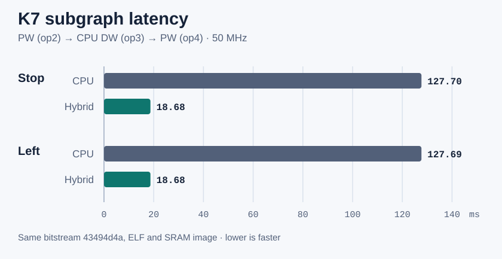
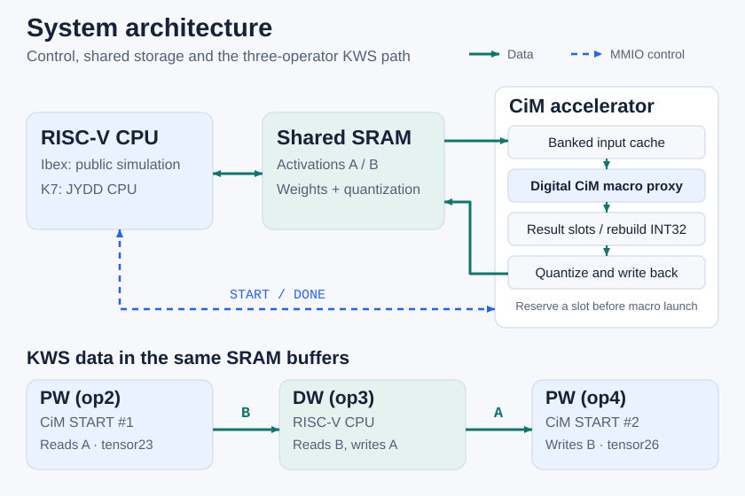

# RISC-V CiM Accelerator

RISC-V 控制的 INT8 加速器，包含可综合 CiM 宏数字代理、开放 Ibex 仿真及经 K7 板测的 KWS 子图。

[English](README.md) · [稳定版 v0.4.0](https://github.com/zlsjtj/riscv-cim-accelerator/releases/tag/v0.4.0) · [Apache-2.0](LICENSE) · 

- **6.83–6.84× 加速**。K7 50 MHz 的三算子子图对照，基线为同一固件中的 RV32IM 标量 C 路径。[板测数据](docs/evidence/kws_subgraph/k7_board.json)
- **Kintex-7 50 MHz 实测**。两条路径使用同一位流和同一 ELF。[构建与时序](docs/evidence/kws_subgraph/k7_build.json)
- **96,000 字节诊断匹配**。两个样本、两条路径、每次捕获三个张量，与 TensorFlow 2.16.1 逐字节一致。[逐张量记录](docs/evidence/kws_subgraph/k7_board.json)

[快速开始](#快速开始) · [系统架构](#系统架构) · [板测结果](#板测结果) · [五分钟讲解](docs/DESIGN_TALK.md)

## 快速开始

在 Ubuntu 或 WSL 安装[公开 Ibex 工具链](docs/IBEX.md#开放-ibex-整机复现)后，从仓库根目录运行：

~~~bash
python3 tools/run_ibex.py
~~~

预期显示 `PASS Ibex M=1`，在 `build/ibex/M1/` 生成两级 INT8 输出和结果 JSON。这是由真实 CPU RTL 执行的合成数据双层快速验证。[输出说明](docs/IBEX.md)

## 板测结果

| 已发布 MFCC 输入 | RV32IM 标量 C | CiM / CPU / CiM 混合路径 | 延迟比 |
|---|---:|---:|---:|
| Stop | 127.703 ms | 18.679 ms | 6.84× |
| Left | 127.694 ms | 18.685 ms | 6.83× |

计时从恢复输入后到最终输出末字可读，包含提交、轮询和 CPU 计算。比较和打印在窗外。每个正式窗口核对最终 8,000 字节，另跑的诊断共比较三个阶段的 96,000 字节。CPU DW 占混合窗口 **94.94%**。[原始 JSON](docs/evidence/kws_subgraph/k7_board.json) · [分段周期与测量口径](docs/KWS_SUBGRAPH.md#k7-50-mhz-实测)

## 系统架构

- **低位运算。** 数字宏代理消费输入位平面，返回原生低位结果。控制器用有符号和无符号分片重建 INT32 累加结果。
- **存储与背压。** 发宏前预约结果容量，输入从分 bank 缓存回放，最后一个 SRAM 写请求被接受后才释放输出上下文。
- **量化与交接。** 逐通道整数双舍入生成 INT8。KWS 的 CPU 从 B 读取 PW1 的实际结果，执行 DW 写 A，再让 PW2 从 A 取数。[RTL 架构](docs/ARCHITECTURE.md) · [五分钟讲解](docs/DESIGN_TALK.md)

## 复现 KWS 子图

先用 TensorFlow 2.16.1 准备固定模型及两条已发布 MFCC 输入，再运行开放 Ibex。诊断选项在正式计时后另跑并核对 tensor24、tensor25 和 tensor26。[依赖、命令与输出](docs/REPRODUCE.md)

K7 流程需要 Vivado 2023.2、授权取得的 JYDD CPU/UART 源码、RV32IM 工具链、板卡、JTAG 及串口。[板级命令](docs/KWS_SUBGRAPH.md#复现) · [归档串口回放](docs/DEMO.md)

| 平台 | 已验证范围 |
|---|---|
| [K7 FPGA 50 MHz](docs/KWS_SUBGRAPH.md#k7-50-mhz-实测) | 两个真实输入的三算子子图，两条路径的计时与逐字节校验 |
| [Ibex RTL 仿真](docs/KWS_SUBGRAPH.md#ibex-rtl-仿真) | RV32IM 固件执行两条真实路径，另有合成数据快速验证 |
| [独立 RTL CI](.github/workflows/rtl.yml) | 官方整数参考、单元测试及固定和可变存储延迟下的 INT8 pointwise 回归 |

| 导航 | 文件 |
|---|---|
| 硬件 | [控制器](rtl/cim_accel.sv)、[数字宏代理](rtl/cim_macro.sv)、[量化器](rtl/requant.sv) |
| 软件与工具 | [KWS 固件](sw/kws_main.c)、[驱动](sw/cim.c)、[数据准备](tools/prepare_kws.py) |
| 证据与历史 | [当前状态](docs/STATUS.md)、[开发历史](docs/STATUS_HISTORY.md)、[发布说明](docs/RELEASE_v0.4.0.md) |

验证范围为固定三算子 KWS 子图和数字宏代理。CPU DW、增加输入和提频列为后续选项。项目代码采用 [Apache-2.0](LICENSE)，外部依赖沿用各自条款。[第三方来源及许可](docs/THIRD_PARTY.md)
