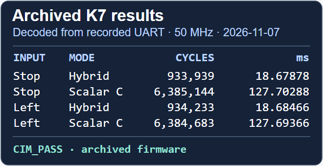

# Recorded UART log replay

The static summary decodes four `KWS_RESULT` records from the K7 board run on
2026-11-07 at 50 MHz. Hybrid and scalar RV32IM C ran on bitstream `43494d4a`
with one firmware. The final `CIM_PASS` line is from the recorded firmware.
[Original UART transcript](evidence/kws_subgraph/k7_board_uart.txt) · [Decoded evidence](evidence/kws_subgraph/k7_board.json)

Replay the archived transcript from the repository root.

~~~bash
printf '%s\n' 'Recorded UART log replay'
cat docs/evidence/kws_subgraph/k7_board_uart.txt
~~~

| Input | Mode | Total cycles | Time (ms) |
|---|---|---:|---:|
| Stop | Hybrid | 933,939 | 18.67878 |
| Stop | Scalar RV32IM C | 6,385,144 | 127.70288 |
| Left | Hybrid | 934,233 | 18.68466 |
| Left | Scalar RV32IM C | 6,384,683 | 127.69366 |

The timed paths each checked 8,000 final bytes. The host checked all
96,000 captured bytes in the separate diagnostic run. The preview
is generated from the UART and JSON records. [Figure generator](assets/generate.py)

For a live run, use the [open Ibex smoke test](REPRODUCE.md#quick-start-with-the-open-cpu)
or follow the [K7 setup (中文)](KWS_SUBGRAPH.md#复现) on the supported board.
