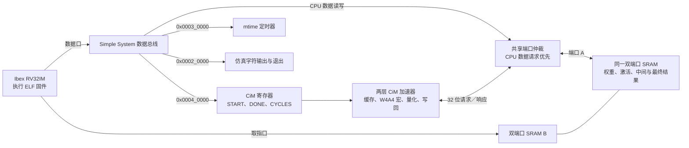

# 开放 Ibex 整机复现

在 Ubuntu 24.04 或 WSL 的 Ubuntu 24.04 安装工具后，从仓库根目录
运行 `python3 tools/run_ibex.py`。首次运行通过网络获取固定的
Ibex 源码。数据为独立整数参考生成的两层确定性输入，整机流程只依赖
公开源码和工具。

```bash
sudo apt-get update
sudo apt-get install -y git verilator gcc-riscv64-unknown-elf g++ make libelf-dev python3-venv
python3 -m venv .venv
source .venv/bin/activate
python3 -m pip install -r tools/requirements-ibex.txt
python3 tools/run_ibex.py              # M1，与 CI 使用同一入口
python3 tools/run_ibex.py --m 125      # 完整双层任务
```

版本基准为 Python 3.12、Verilator 5.020、GNU RISC-V GCC 13.2.0、
FuseSoC 2.4.3、Edalize 0.6.1。Ibex 固定在
[`2373e5d`](https://github.com/lowRISC/ibex/tree/2373e5dadcfc4f56672962fa242f6a051acc9aca)。
脚本在 `build/ibex/upstream` 获取该版本，并应用小型
[`simple-system.patch`](../sim/ibex/simple-system.patch)。
`--out` 可指定独立构建目录，`RISCV_CC` 可选择编译器。

## 整机结构



Ibex 取指从 `0x00100080` 开始。端口 A 同时服务 CPU 数据访问和
CiM，CPU 请求优先，返回用已寄存的所有者标签分流。端口 B 独立取指。
CiM MMIO 按 Simple System 总线约定在下一拍回应。加速器使用
MODE1、层间保留、提前回放和提前写回。C 驱动依次写入两个任务的
地址，提交一次 START，然后轮询 DONE。

## 核对结果

启动前固件将中间和最终区预置为各自 golden 的反码。DONE 后，固件
读两段 SRAM，逐字节比较并把真实输出写到仿真字符设备。运行器独立
用 Python 直接 MAC golden 检查输出，并核对 RTL 的 START、DONE
和 SRAM 握手计数。只有所有检查通过才生成结果 JSON。

在 `build/ibex/M1/` 或 `build/ibex/M125/` 查看：

- `result.json` 含周期、流量、输入与输出哈希。
- `intermediate.bin` 和 `final.bin` 为 CPU 从 SRAM 读出的原始 INT8。
- `ibex_simple_system.log` 是 CPU 字符输出，`simulator.log` 保存
  硬件计数与退出记录，`trace_core_00000000.log` 记录 CPU 执行。

端到端按 Ibex 的 `mtime` 采样，从数据就绪到 CPU 读取最终输出
末字后。核内周期读 CiM 的 `CYCLES`，两者都排除 golden 比较和
输出打印。该仿真独立于 [K7 同位流对照](TWO_LAYER_COMPARISON.md)。

|Ubuntu 24.04 / Verilator 5.020|每层零失配字节数|CPU 计时窗口（拍）|CiM 核内（拍）|共享 SRAM 读 / 写（字）|
|---|---:|---:|---:|---:|
|M1|64|9,898|9,033|2,448 / 32|
|M125|8,000|40,189|39,338|4,432 / 4,000|

两次各有一次接受 START 和一次 DONE。保存了复位 PC、固件写
`0x3d` 到 CONTROL、CPU 读最终末字和仿真退出的记录。
[M1 JSON](evidence/ibex_2026-11-06/M1.json) ·
[M125 JSON](evidence/ibex_2026-11-06/M125.json) ·
[指令和 MMIO 轨迹节选](evidence/ibex_2026-11-06/execution.txt)
